<div align="center">

# 🌙 Athan App Mac

**Prayer times that live in your MacBook's notch.**

A Dynamic Island-style app for macOS: it shows the next prayer around the camera notch and drops down briefly when it's time to pray. It stays out of the way during calls, and nothing it shows appears in screenshots or screen shares.

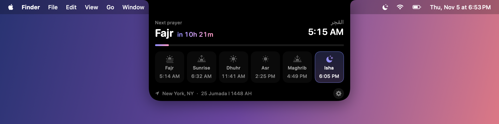

</div>

## Install

You need a Mac on **macOS 14 Sonoma or later**. A MacBook with a notch looks best; on other screens the island floats under the menu bar instead. Paste this into Terminal:

```bash
curl -fsSL https://raw.githubusercontent.com/APasha1/AthanAppMac/main/install.sh | bash
```

The installer downloads the source, builds it on your Mac with Apple's Swift toolchain, puts **Athan App Mac** in `/Applications` and opens it. If you don't have Apple's Command Line Tools, it starts their install first. Run the same command again to update.

### Install with an AI agent

If you use Claude Code, Codex, Cursor or another coding agent, just ask:

> Install Athan App Mac from https://github.com/APasha1/AthanAppMac

[AGENTS.md](AGENTS.md) has the steps an agent follows to install, check and configure the app.

### Build it yourself

```bash
git clone https://github.com/APasha1/AthanAppMac.git
cd AthanAppMac
./build.sh
open "/Applications/Athan App Mac.app"
```

## First launch

A short setup walks you through everything. Afterwards, Settings has it all.

| | |
|---|---|
| 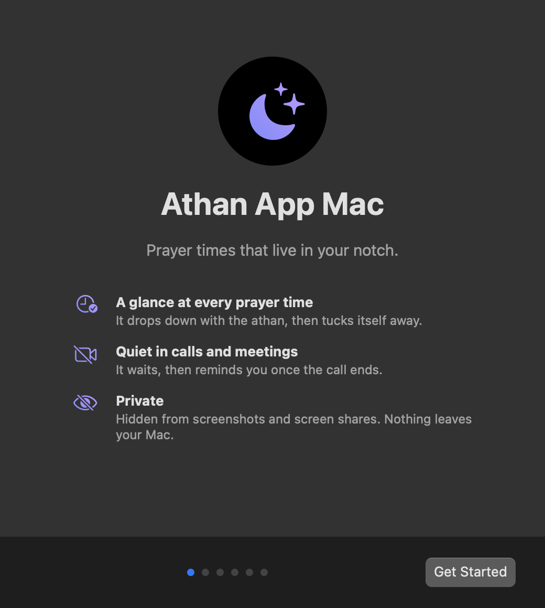 | 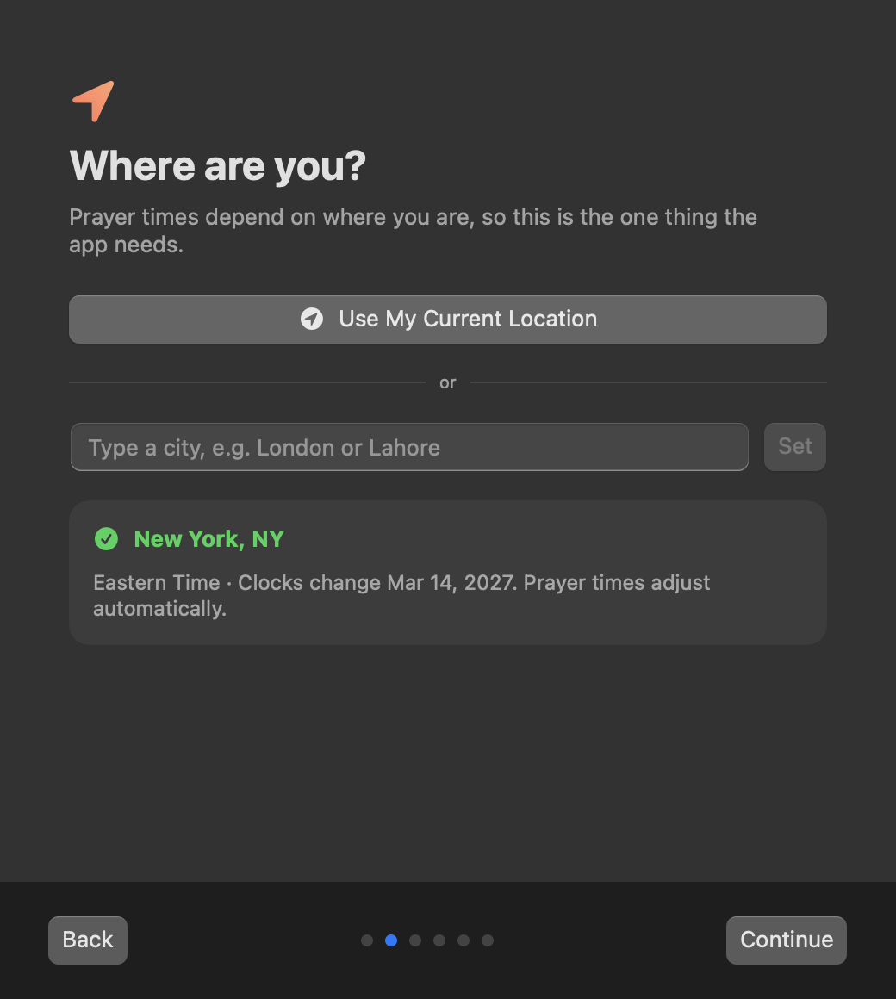 |
| **Welcome**: what the app does | **Location**: use your current location or type any city. It shows your time zone, and times follow daylight saving automatically. |
| 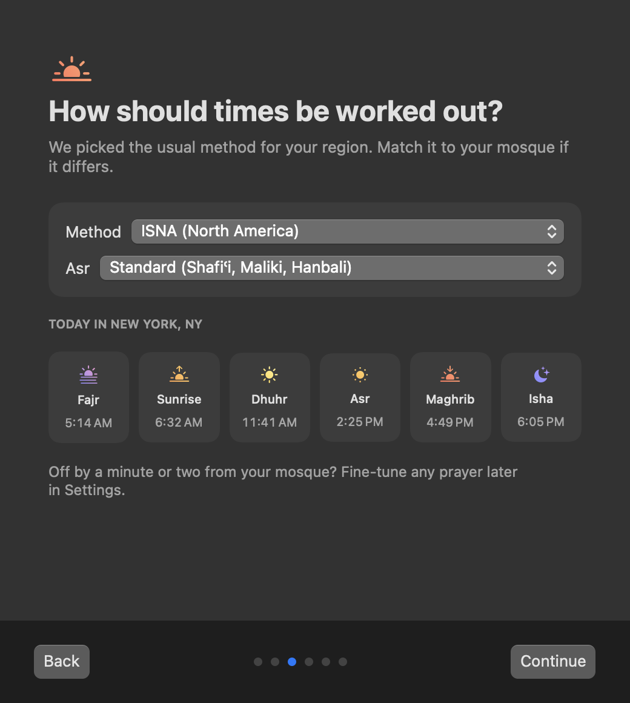 | 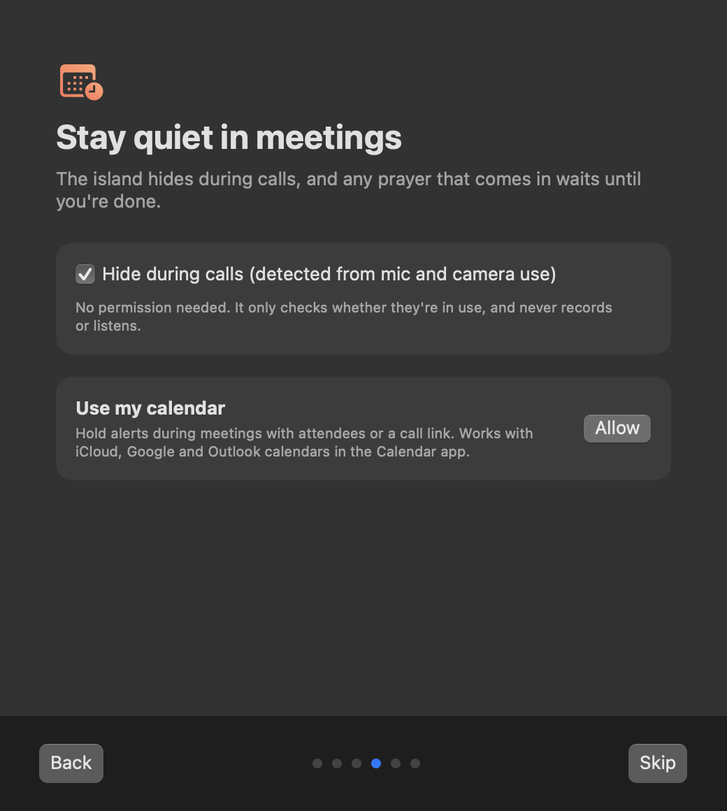 |
| **Calculation**: method and Asr school, with a live preview of today's times | **Meetings**: hide during calls, and optional calendar access |
| 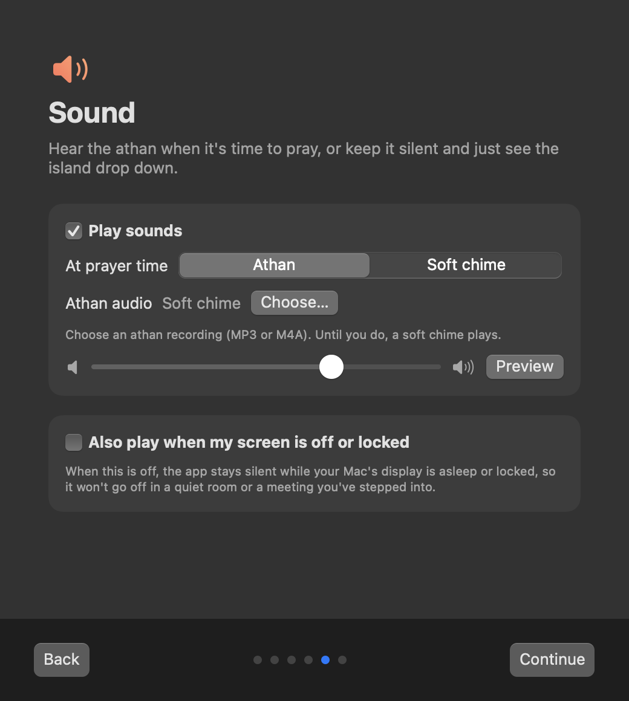 | 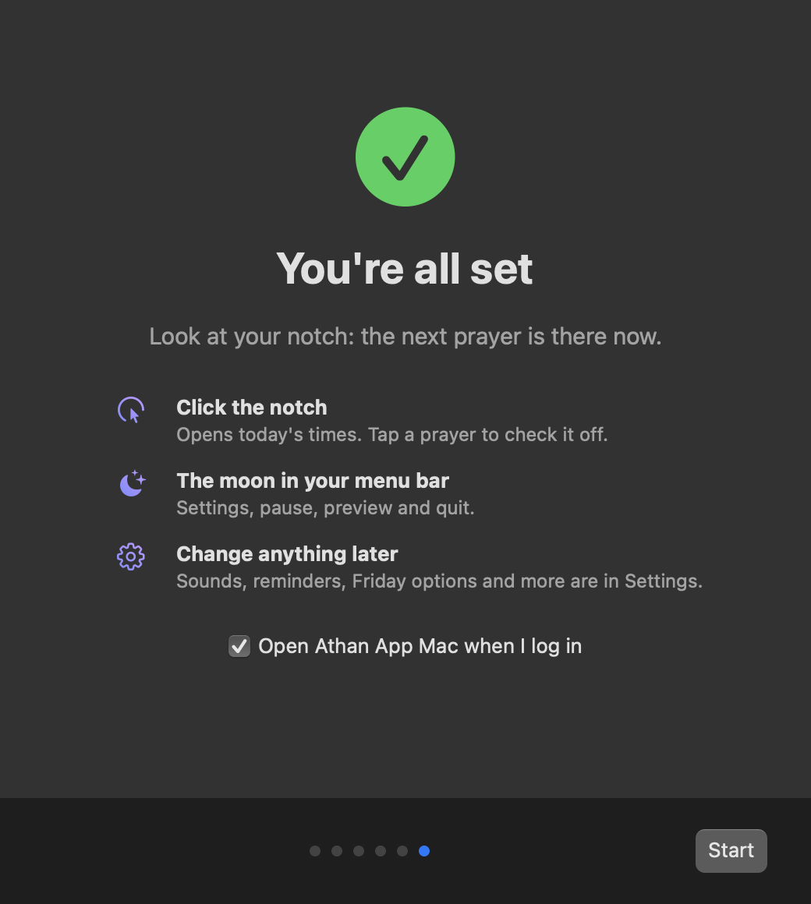 |
| **Sound**: athan, soft chime or silent, and whether to play while the screen is off or locked | **Done**: tips, and open at login |

Times always follow your Mac's time zone, so they're right wherever you are, and the clock changes in spring and autumn need no setting.

## Features

### Lives in the notch

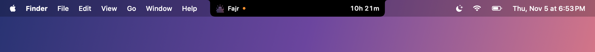

- The next prayer and a live countdown sit on either side of the camera notch, like a Dynamic Island.
- **Click the notch** to open today's full schedule: all six times, a progress bar to the next prayer, the Hijri date and your location.
- Tap any prayer to check it off. An orange dot reminds you about one you haven't marked.
- Everywhere outside the black shape, clicks go straight through to your apps, so it never blocks your work.

### Glances at prayer time

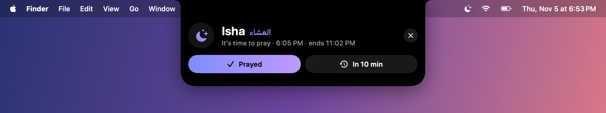

- When a prayer comes in, the island drops down with the athan (or a soft chime), then tucks itself back into the notch after a few seconds.
- Mark it **Prayed**, or snooze it for 10 minutes.
- An optional heads-up before each prayer (5–30 minutes).

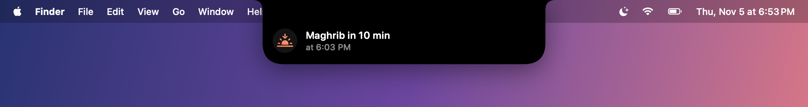

### Respects your meetings

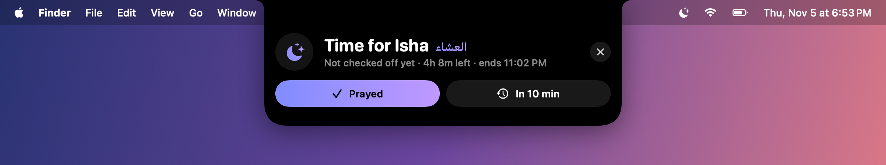

- It **hides completely while you're on a call**. It detects calls from microphone and camera use, so Zoom, Meet, Teams, FaceTime and Slack huddles all count.
- It reads your calendar (iCloud, Google, Outlook/Microsoft 365 or any ICS link) and **holds alerts during real meetings**: ones with attendees or a call link. Focus blocks and classes don't count.
- **It reminds you after the call** about any prayer that came in while you were talking.
- If a meeting would run past the end of a prayer's time, it suggests praying first:

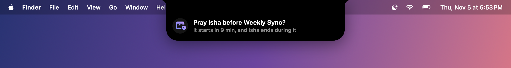

### Never miss a prayer

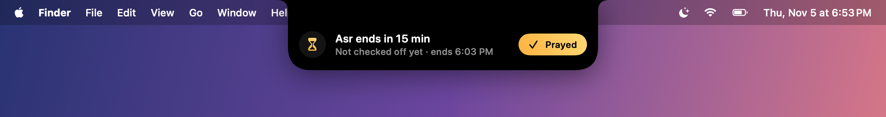

- If you haven't checked a prayer off, it reminds you **15 minutes before its time ends**, with a one-click **Prayed** button.
- If your Mac wakes from sleep, it won't fire a stale alert for a prayer whose time has already passed.

### Fridays

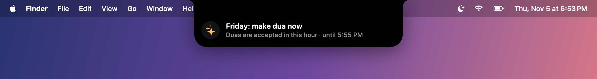

- **Skips Dhuhr on Fridays**, since you're at Jummah (you can turn this off).
- A **Friday dua reminder** in the last hour before Maghrib, the hour when duas are accepted. If you're on a call then, it waits until the call ends.

### Private by design

- **Invisible in screenshots, recordings and screen shares** (Zoom, Meet, QuickTime, ⌘⇧5). A toggle in the menu bar lets you show it when you want to.
- In full screen it stays hidden, and only comes down for prayer time.
- Prayer times are worked out **on your Mac and work offline**. No account, no analytics, and nothing is sent anywhere. Your calendar is read only on your Mac.

### Accurate times, your way

- **8 calculation methods**: ISNA, Muslim World League, Umm al-Qura (Makkah), Egyptian, Karachi, Dubai, Singapore/Malaysia and Diyanet (Turkey). It picks one based on your region.
- **Asr**: Standard (Shafiʿi, Maliki, Hanbali) or Hanafi.
- It uses your current location, or you can search for any city.
- **Fine-tune any prayer by ±30 minutes** to match your mosque or another athan app.
- Handles daylight-saving changes and high latitudes.
- Choose your own athan audio, with a separate one for Fajr if you like, and set the volume.
- **Sound your way**: athan, soft chime or fully silent. By default it stays quiet while your screen is off or locked, so it never goes off in an empty room; you can turn that on.

### Native and lightweight

- Built in Swift and SwiftUI. It's a menu-bar app with no Dock icon.
- **Opens at login** and keeps running through sleep and restarts.
- A moon icon in the menu bar has today's times, Pause, Preview and Settings.

## Permissions

| Permission | Why | Required? |
|---|---|---|
| Location | To work out prayer times where you are | No: you can pick a city instead |
| Calendars | To stay quiet during meetings | No |

Detecting the microphone and camera only checks *whether* they're in use. The app never records or listens to them.

## Settings

Open them from the moon icon in the menu bar, or the gear in the expanded island:

- **Location**: automatic, or search for a city
- **Calculation**: method and Asr school
- **Fine-tune times**: per-prayer adjustments
- **Reminders**: heads-up, end-of-time reminder, skip Friday Dhuhr, Friday dua, athan sounds and volume
- **Meetings**: hide during calls, calendar, ICS link, mic and camera detection
- **Island**: open on click or hover, how long the glance stays, hide from screenshots, side labels, open at login

## Uninstall

```bash
curl -fsSL https://raw.githubusercontent.com/APasha1/AthanAppMac/main/install.sh | bash -s -- --uninstall
```

## How it works

| File | What it does |
|---|---|
| `PrayerTimes.swift` | Offline astronomical calculation, based on the PrayTimes.org algorithm |
| `PrayerStore.swift` | Decides when to glance, remind, hold or defer |
| `FocusMonitor.swift` | Call detection (CoreAudio / CoreMediaIO) and meetings (EventKit + ICS) |
| `NotchWindow.swift` | The borderless, click-through panel over the notch, excluded from capture |
| `IslandView.swift` | The SwiftUI island: compact, glance, expanded and alert |

To regenerate the screenshots in this README, run `.build/release/AthanAppMac --snapshot <dir>`. It renders every island state to PNGs.

## License

[MIT](LICENSE)
